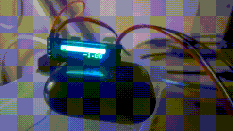
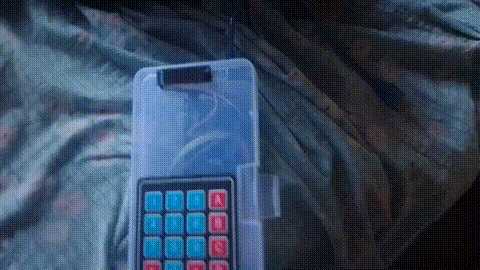

This project is originally for school project, but interesting enough to be invested on and give some time to get serious

## demo



# this project contains the following
- simple arduino UI
- expression evaluator (calculator but for CS people)
- and usage of the OLED

# this project uses
- arduino uno r3
- SSD1306 0.91 OLED display (super small)
- 4x4 keypad (not enough)
- GNU make for build, upload, monitor
- arduino-cli (cus why not)

on this project i use all my knowledge in computer engineering and programming skill to explore embeded for the first time

# compile
first prerequisite
- arduino-cli
- GNU make
- U8g2 lib

compilation
```console
$ make # or `make compile` to compile all
$ make upload # or add `PORT=/dev/<PORT>` to enter without promting, this will also monitor and compile
$ make monitor # or add `PORT=/dev/<PORT>` to enter without promting
```

## file structure
Arduino_calculator
├── first_prj.ino         - program's entry point
├── LICENSE               - LICENSE
├── makefile              - build system
├── README.md             - this file
└── src                   - source code
    ├── arduino           - arduino specific code
    │   ├── display.cpp   - processing display
    │   ├── display.hpp   - header
    │   ├── keyboard.cpp  - keyboard handler lib
    │   └── keyboard.hpp  - header
    ├── key_handler.hpp   - key event processor
    ├── libs              - lib thats not specific to arduino
    │   ├── calc.h        - my calc.c from hitoyaCute/MEU_CLibs
    │   └── str_acc.hpp   - string accumulator
    ├── main.cpp          - where it all starts
    └── main.hpp          - interface to allow first_prj.ino to use the project
